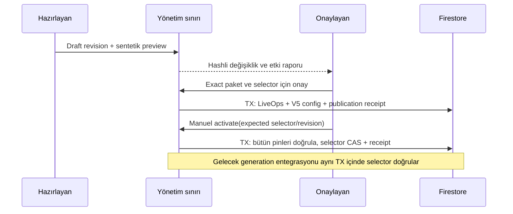

# BACKEND-11 DESIGN-00 — LiveOps yönetim mimarisi

28 Ekim 2026. **Tasarım teslimi: PASS; uygulama yetkisi: verilmedi.** Bu belgedeki PROPOSED öğeler öneridir; onaylanmış veya uygulanmış bileşen değildir. İnceleme tabanı `main`, `d58e8a134347723a147b56a06ab397caa602d781`; tarihsel test kaynak kimliği `f2b7058e006a2b6f2fc46d12546e347b6dedf722`.

## 1. Yönetici özeti

Öneri: oyuncu callable yüzeyinden ayrı, küçük ve güvenilir bir yönetim servisi sınırı; iki yetki (hazırlayan ve onaylayan/yayımlayan); düzenlenebilir taslak, değişmez onay kanıtı, atomik katalog yayını ve ayrı manuel selector CAS aktivasyonu. İlk LOCAL uygulama kalıcı HTTP servisi yerine bu sınırın manuel süreç adaptörüyle denenebilir. Gerçek yönetici kimliği veya hesap varlığı varsayılmaz. Kimlik sağlayıcı ve operatör atamaları onaylanmadan yönetim yazarı etkinleşmez.

Normal event başlangıç/bitişi için scheduler gerekmez. Mevcut sunucu saatiyle saf seçim korunur. Yayınlama, yeni LiveOps katalog belgesi yanında onu pinleyen yeni V5 contract config gerektirir. Önce publish, sonra ayrı activate; yalnız selector değişimi oyuncu okuma görünümünü etkiler. Tarihsel fiyatlar, V1–V5, V2 maliyet ve V3 banka hesabı değişmez.

**Kritik kaynak bulgusu:** mevcut teklif üreticisi selector okumaz; iç planın `configVersion` değerini kullanır. Dolayısıyla bugün selector değiştirmenin yeni teklifleri kendiliğinden yönettiği iddia edilemez. Gelecekte aynı generation transaction'ına selector doğrulaması eklenmesi, ayrıca yetkilendirilmesi ve yarış testleriyle doğrulanması gerekir (§6). Bu tasarım bu boşluğu gizlemez.

## 2. Kaynakla doğrulanmış mevcut mimari

Referans kökü `backend/functions/src/`; semboller belirtilen main SHA'sında incelendi. EXISTING etiketi mevcut kodu belirtir.

| EXISTING dosya / sembol | Doğrulanan davranış ve tasarım etkisi |
| --- | --- |
| `liveOpsModel.ts`: `validateLiveOpsCatalog`, `eventDefinition`, `LIVEOPS_POLICY` | Exact schema1; `synthetic_emulator_only`; economy/logistics/market/policy pinleri. En fazla 16 event, 16 şehir/5 cargo scope, süre en fazla 31 gün, priority 0..1000. Boş events dizisi geçerli; boş tek-event scope geçersiz. Onay workflow metadatası katalog içine eklenemez. |
| `liveOpsModel.ts`: `eventStatus`, `selectEvent`, `liveOpsQuote`, `validateLiveOpsQuote` | Yarı açık UTC aralığı; highest priority/ASCII ID; tek modifier; original base üzerinden combined clamp + tek BigInt floor. Snapshot bağımsız aritmetik ve hash kontrolü taşır. |
| `liveOps.ts`: `readMyWorldEvents` | Foundation/starter → economy-scoped selector → `readContractConfig`; V5/liveOps zorunlu. Read-only transaction; 7 gün ileri/24 saat geri takvim penceresi, enabled kayıtlar, en fazla 16. `currentEventIds` bütün görünen aktif olaylardır; tek fiyat kazananı listesi değildir. |
| `market.ts`: `readMyMarketState`, `readPinnedMarket` | Selector exact `{schemaVersion,approval,contractVersion,contractHash}`. Historical reader güncel selector yerine original config/market epoch/event selectedAt ile `makeTerms` recompute eder. |
| `contractEligibility.ts`: `readContractConfig` | `v2ContractCatalog` → logistics → costs → market → V5 liveOps. Market/liveOps hash doğrulanır. Cost hash eşitliğinin fiyatlama aşamasında `makeTerms` tarafından ayrıca doğrulandığı unutulmamalı; salt loader publish doğrulaması değildir. |
| `contractModel.ts`: `validateContractConfig`, `makeTerms`, `validateContract`, `contractIdFor` | V1–V5 dispatch; config bütün pinleri taşır. V5 reward final gross; V4 reward market gross. Pool IDs company/epoch/slot; event veya config eklenerek yeni pool kotası yaratılamaz. |
| `contracts.ts`: `generateContractOffers`, `readPool`, `acceptContractCommand` | Generation internal `{configVersion,epoch,assets}` planı alır; selector okumaz. İlk event zamanı/durumu ve market epoch SDK retry boyunca pinlenir. Acceptance orijinal terms'i yeniden hesaplar. |
| `operatingCosts.ts`: `makeCostQuote`, `readPinnedCosts` | Final gross üzerinden V2 maliyet/net; gross <= costs ret. Original costs/market/event pinleri yeniden okunur; fallback/reprice yok. |
| `settlement.ts`: `prepareDeliverySettlement`, `validateSettlementJournal` | Bank policy varsa V3'e dispatch; aksi halde V1/V2 korunur. Mevcut tek finansal işlem ve historical journal doğrulaması. |
| `bankSettlement.ts`: `prepareBankSettlement`, `validateBankSettlement` | Claim transaction'ındaki current loan, tek wallet, repayment ve journal atomik. Historical journal kendi pinned loan terms'ini doğrular; güncel krediyle yeniden hesaplanmaz. |
| `bankModel.ts`: `repayment`, `checkedAdd`; `economy.ts`: `planEconomyMutation` | Reserve/debt cap, fee-first, BigInt available ve final balance/XP sınırları. Admin preview aynı saf kuralları kullanmalı. |
| `commands.ts`: `canonicalJson`, `executeCommand`, `responseFromReceipt` | UID/player commands namespace, company resolver, 8 KiB request/result, permanent receipt; auth/ownership replay öncesi. Admin authorization ve global selector scope sağlamaz. |
| `logisticsModel.ts`: `digest`; `economyModel.ts`: `versionId`, `configHash` | Canonical JSON sorted object keys, ordered arrays; SHA-256, digest girdisi 32 KiB sınırı. Version `[A-Za-z0-9][A-Za-z0-9_-]{0,63}`. Array sırası hash parçasıdır. |
| `identity.ts`: `requireUid`, `createLocalFirestore`; `localEnvironment.ts`: `assertLocalEnvironment` | Oyuncu kimliği admin rolü değildir. Exact demo/loopback ve credential rejection; cloud fallback yok. Emulator kimliği gerçek yönetici doğrulaması sayılamaz. |
| `index.ts` | Import aşamasında LOCAL guard; callable export'ları oyuncu işlemleri ve okumalar. `generateContractOffers` export edilmez; yayınlama/onay endpoint'i yok. |
| `backend/firestore.rules`, `backend/firebase.json` | Bütün client read/write default-deny; yalnız loopback emulator config. Yönetim yetkisi Rules gevşetilerek verilemez. |

Okunan kanıtlar: BACKEND-10 POST_MERGE_REPORT, FINAL_REVIEW, LOCAL_RISK_ACCEPTANCE, REPORT, SIMULATION_REPORT; LIVEOPS_CONTRACT, EVENT_PRICING_CONTRACT, MARKET_CONTRACT ve BANK_SETTLEMENT_CONTRACT. Tarihsel başarısız 128/6 ve 123/11 koşuları, sonraki 134/134 emulator PASS ile silinmez. POST-MERGE build/typecheck, unit 43/43 ve offline 85/85 + 8/8 bu görevin yeni testleri değildir.

## 3. Eksik yönetim kabiliyetleri

EXISTING: immutable kabul edilen katalog okuyucuları, strict validasyon ve hash pinleri vardır; yetkili Admin'in belgeyi fiziksel olarak değiştiremeyeceği bir depolama garantisi yoktur. Yeni admin workflow; hesap/rol registry, draft, approval, publication receipt, activation CAS, audit UI, scheduler ve otomatik retention mevcut değildir.

PROPOSED: aşağıdaki dört küçük admin koleksiyonu ve izole komut sınırı. Yayınlanan finansal içerik mevcut kataloglarda tek canonical kaynak olarak kalır. Admin metadata katalogların ikinci aktif kopyası veya alternatif fiyat motoru olmaz.

## 4. Önerilen minimal mimari

Hazırlayan → pure validate/preview → farklı onaylayan → immutable publish → aynı onay kapsamındaki manuel activate. Yönetim servisi salt katalog/selector işlemleri sunar; generic document path, raw Firestore write, finance mutation veya oyuncu UID adına komut çalıştırma sunmaz.

İlk sürümde bir proposal tek yeni LiveOps + tek yeni V5 config yayımlar. Economy/logistics/cost/market/bank politikası mevcut pinlerden alınır; editor bunları ve base gross/route/cargo/epoch/quota değerlerini değiştiremez. Önceki V5 config'ten yalnız `version,liveOpsVersion,liveOpsHash` farkına izin verilir. V4→V5 ilk geçiş ayrıca açık transition approval gerektirir. Başka katalog veya sayısal politika değişimi ayrı fazdır.

Yönetim okuma/preview aracı ile finansal yazı yetkisi birbirinden ayrılır. LOCAL test adaptörü sahte iki principal'ı yalnız sentetik fixture olarak kullanabilir; bu gerçek iki kişi onayı veya production MFA kanıtı değildir. Bu belgenin yazılması hiçbir principal yaratmaz.

## 5. Katalog yaşam döngüsü

Önerilen kalıcı proposal durumları: **DRAFT → PENDING_APPROVAL → APPROVED → PUBLISHED**. `REJECTED` ve `CANCELLED` terminaldir. Reddedilmiş/düzeltilmiş içerik yeni proposal'a klonlanır; geçmiş karar düzenlenmez. `VALIDATED` ayrı durum değil, revision/contentHash/validatorVersion/previewDigest'e bağlı kanıttır. Draft değişince kanıt geçersizdir. Pending içerik dondurulur; değişiklik için iptal ve yeni proposal gerekir.

`ACTIVE` ve `SUPERSEDED` katalog alanı değildir: mevcut selector ve activation history'den türetilir; aynı version yeniden seçilebilir. `ROLLED_BACK` bir activation audit action'ıdır; immutable catalog state'i değiştirilmez. Yayınlanmış proposal iptal edilmez; yalnız henüz kullanılmamış activation izni geri çekilebilir.

Tüm yazı geçişleri için ortak protokol: doğrulanmış actor, exact request, action+environment+actor+idempotencyKey kapsamlı operationId; canonical fingerprint; beklenen revision; güncel yetki/revocation kontrolü; receipt+domain yazılarının tek transaction'ı. Aynı key/aynı fingerprint original sonucu döndürür; farklı fingerprint `IDEMPOTENCY_CONFLICT`. Terminal domain retleri sanitized error receipt olarak commit edilebilir; transient transport hatası başarı receipt'i üretmez. SDK retry side-effect yaratmaz. Tablo bu protokolün her satıra uygulanmasını zorunlu kılar.

| Geçiş | Actor / girdi / validasyon | Storage, atomicity, audit | Hata/retry / oyuncu görünümü |
| --- | --- | --- | --- |
| Yok→DRAFT | Editor; bounded catalog intent, sabit parent pins; strict şekil | Proposal create + operation receipt | ID collision ret; aynı key replay; görünüm yok |
| DRAFT→DRAFT edit | Sahip editor; expectedRevision; izinli alanlar | Revision artır, validationRef temizle + receipt | Stale revision ret; otomatik rebase yok; görünüm yok |
| Validate/preview | Editor veya releaser; exact revision, sentetik scenario set | Pure preview write0; isteğe bağlı açık validation-record komutu kanıt ref'i + receipt yazar | Invalid ret, örnek kapsamı açık; preview publish yapmaz |
| DRAFT→PENDING_APPROVAL | Editor; validation ve preview digest, locale manifest hash | İçerik dondur + submit receipt; kanıtlar yeniden doğrulanır | Stale evidence ret; yeniden key kör tekrar değil; görünüm yok |
| PENDING→APPROVED | Farklı releaser; proposalHash, action scope, expected selector, expiry/notBefore | Immutable approval operation + proposal approvalRef aynı transaction | Self-approval/expired/stale selector ret; görünüm yok |
| PENDING→REJECTED | Releaser; sabit reasonCode | Proposal + immutable decision receipt | Aynı key replay; yorumda secret yok; görünüm yok |
| DRAFT/PENDING/APPROVED→CANCELLED | Editor kendi taslağında; releaser tüm unpublished durumlarda | Proposal ve receipt; publish yarışında transaction conflict | Published ise ret; görünüm yok |
| APPROVED→PUBLISHED | Releaser; exact approval/hash ve fresh validasyon | İki immutable katalog create + proposal + publication receipt atomik | Partial publish yok; hash collision ret; player etkisi yok |
| PUBLISHED→selector seçimi | Releaser; activation approval, expected selector/revision | Selector + control + activation receipt tek CAS transaction | Conflict/expired approval ret; aynı key original replay; yalnız yeni authority görünür |
| Selector→önceki published config | Releaser; ayrı rollback approval, fresh preview/CAS | Yeni activation revision + rollback receipt; eski kataloglara yazı yok | Stale rollback ret; yeni fiyat otoritesi değişir, tarihçe değişmez |

Approval body; draft revision/contentHash, validator/preview/scenario/localization manifest hash'leri, bütün dependency pinleri, exact target config, expected selector tuple+updateTime+controlRevision, environment, actor/approver, notBefore/expiresAt ve izin verilen publish/activate action'larını içerir. Expiry LOCAL risk bitişini aşamaz. Publish sonrası selector değişirse aynı onayla aktivasyon yapılamaz; published hedef için yeni immutable activation approval gerekir. Aynı request'in receipt replay'i tekrar aktivasyon yapmaz.

## 6. Yayınlama ve selector akışı

### Sürüm ve hash

Yeni sürüm ID'leri server-generated, `versionId` uyumlu, proposal ile kalıcı rezerve edilir. İçerik hash'inden kendini içeren version üretme döngüsü kurulmaz: önce version atanır, sonra normalize edilmiş tam katalog `digest` ile hash'lenir. Hash içine mevcut schema'nın titleKey/descriptionKey dahil bütün alanları girer. Array sırası onay sonrasında yeniden sıralanmaz. SHA-256 imza veya yetki kanıtı değildir.

Dependency DAG: canonical `v2WorldConfig` + `v2LogisticsCatalog` → mevcut market/cost; yeni LiveOps market/economy/logistics pinler; yeni V5 config costs/market/liveOps ve bankPolicy pinler; selector yeni config version/hash taşır. Bütün hash'ler validator çıktılarından yeniden hesaplanır. Cost hash, cargo coverage, template maliyet eşleşmesi ve positive net ayrıca `makeTerms` ile kontrol edilir.

### Atomik publication

Tek transaction içinde önce principal/receipt/proposal/approval ve bütün pin/target belgeleri okunur; yetki ve expiry yeniden değerlendirilir. Ardından yeni LiveOps ve config belgeleri `create`, proposal PUBLISHED update ve publication receipt create. Selector bu adımda değişmez. Catalog body'ye createdBy/status/approvalRef eklenmez; exact validator bunları reddeder. Bu metadata receipt'tedir. Küçük iki-belgeli paket için staging koleksiyonu veya saga gereksizdir.

Aynı operation sonrası response loss: mevcut receipt'e güncel yetkiyle erişilir, original result/committedAt döner. Yeni key ile aynı target istenirse matching publication receipt + iki hash birlikte doğrulanır; başka onay sahibi adına sahiplenme yok. Hedeflerden biri var diğeri yoksa beklenmeyen partial/out-of-band yazım sayılır, HOLD; sessiz tamamlama/overwrite yok. Transaction kesilirse ya ikisi de yoktur ya ikisi ve receipt vardır. Yayınlanmış fakat aktive edilmemiş paket normal ve güvenlidir.

### Selector compare-and-swap ve ABA

Mevcut selector exact dört alanını korur; revision eklemek mevcut okuyucuları bozar. PROPOSED `v2LiveOpsActivationControl/{economyVersion}` yalnız CAS metadata taşır: monoton revision, lastOperationId, observedSelectorHash. Finansal otorite yine tek `v2MarketSelection` belgesidir. Sidecar yoksa kendiliğinden seed edilmez; ilk kurulum ayrı explicit LOCAL bootstrap kabul testi ister.

Activation transaction: bütün read'ler önce; actor/approval/receipt, selector ve control, publication receipt, target config + tüm bağlı katalogları doğrula. İstek expected contractVersion/hash **ve selector snapshot updateTime** ile control revision'ı taşır. A→B→A dönüşünde eski A onayı content aynı olsa da updateTime/revision nedeniyle reddedilir. Selector ile sidecar uyumsuzsa HOLD. Transaction sonunda dört alanlı selector, incremented control ve receipt atomik yazılır. Approval action id'si yalnız bir başarılı activation'a tüketilir; yeni idempotency key aynı approval'ı ikinci kez kullanamaz. Yeni rollback approval bağımsızdır.

Firestore callback yeniden çalışabilir; approval/clock/CAS kontrolleri her attempt'ta yapılır, e-posta/telemetry/harici yan etki callback'te yoktur. Mutlak commit-at-exact-time garantisi verilmez; saat kapısı callback kabul anına aittir, kısa işlem bütçesi ve expiry yeniden kontrolü gerekir. Bütün reads writes öncesindedir; commit başarısızsa kısmi domain state yoktur. Bu davranış resmi [Firestore transaction sözleşmesi](https://firebase.google.com/docs/firestore/manage-data/transactions) ile uyumludur.

### Mevcut generation boşluğunun sınırlı kapatılması (PROPOSED)

`generateContractOffers` bugün trusted plan version'ını kullanır. Gelecek LOCAL entegrasyonda aynı transaction içinde canonical economy selector okunmalı; plan config/hash ile eşleşmeli ve seçilen config sadece sunucuda çözülmelidir. Transaction dışı selector okuması yeterli değildir. SDK retry farklı selector/config görürse ilk attempt'ın identity pin'iyle ret; otomatik yeni fiyat seçimi yok. Commit ile yarışan selector yazısı conflict/retry yoluyla değerlendirilir.

Bu değişiklik internal girişte kalır; yeni public generator, client version parametresi veya admin'in şirketlere pool üretmesi önerilmez. Mevcut receipt replay original sonucu döndürür; current selector'a göre yeniden üretmez. Var olan pool yenilenmez; event veya config aktivasyonu ekstra pool sağlamaz. EpochDuration/TTL/quota/template ordering ilk release kapsamı boyunca sabit tutulur; farklı epoch düzeni yeni ID/ek pool riski nedeniyle ayrı migrasyon tasarımı ister. Bu bağ kurulmadan “activation yeni teklifleri yönlendiriyor” kabul kriteri PASS olamaz.

## 7. Yönetici güvenlik modeli

| Boyut | A: ayrı güvenilir yönetim servisi | B: authenticated backend admin API |
| --- | --- | --- |
| Kimlik | Ayrı operator identity; ileride kısa ömürlü güçlü doğrulanmış session/MFA | Firebase ID token doğrulama + özel rol kaydı; oyuncu UID tek başına yetmez |
| İzin | İki capability ve environment allowlist; server kontrolü | Aynı capability kontrolü her callable'da; public attack surface daha geniş |
| Ayrı onay | Actor != approver; approval exact hash'e bağlı | Aynı ayrım mümkün, oyuncu token/claim karışıklığı riski daha yüksek |
| Secret | LOCAL cloud credential yok; ileride keyless identity ayrı tasarım | Admin SDK yine sunucuda; client'ta service-account key kesinlikle yok |
| İzolasyon | Player endpoint/export bağımsızlığı, manual LOCAL süreç | Ortak runtime/export hatası admin işlemini açabilir |
| Audit/replay | Ayrı namespace, global scope doğal | Player command wrapper doğrudan uygun değil |
| İşletim | Bir küçük adapter ek bakım; ilk LOCAL listener gerektirmez | Ortak HTTP altyapısı kolay; rate/session/abuse yükü daha fazla |
| İstismar sınırı | Compromised service writer ciddi risk; IAM tek başına belge immutability sağlamaz | Forged/stale claims, public probing ve rol yükseltme ayrıca ele alınır |

**Öneri A**, proje ölçeği için tek küçük admin domain + manuel LOCAL adapter; mikroservis ağı veya yeni frontend zorunlu değil. Gerçek deployment/topology seçimi onay bekler. B, doğrulanmış admin identity ve revocation tasarımı tamamlanırsa alternatiftir. Firebase custom claim yalnız privileged server'dan atanabilir; yeni token'a yayılması gerekir, client'ın gönderdiği düz role alanı güvenilmez. [Firebase custom claims](https://firebase.google.com/docs/auth/admin/custom-claims).

Minimal yetkiler: EDITOR (draft/edit/submit/preview), RELEASER (preview/reject/approve/publish/activate/rollback). Aynı kimlik iki capability taşısa da kendi proposal'ını onaylayamaz. Yetki atama/revocation, bu LiveOps API'sinin dışında owner-controlled ayrı provisioning sınırıdır. Her işlem ve receipt okumasında enabled principal/environment grant kontrol edilir; approve ve activate transaction'ları approver'ın hâlâ enabled olduğunu da okur. Bootstrap yapılandırılmadan fail-closed; varsayılan admin yok.

LOCal emulator Auth sahteciliğe dayanıklı bir internet kimlik sistemi değildir; iki test UID'si gerçek görev ayrılığı sağlamaz. Trusted workstation varsayımı açık kalır. Gerçek ortamda audience/issuer/expiry/revocation, güçlü yeniden doğrulama, kısa session ve abuse limitleri ayrı güvenlik kabulü gerektirir. Admin SDK, client Rules'ı bypass eder; server authorization ve sınırlı service identity gerekir. [Firebase server erişim sınırı](https://firebase.google.com/docs/firestore/security/insecure-rules). Owner-level credential compromise'a karşı bu şema tek başına değişmez audit garantisi vermez.

Unity/public client event oluşturamaz/onaylayamaz, multiplier/time/version seçemez veya katalog değiştiremez. Payload actor/role/projectId alanları kabul edilmez; trusted context'ten çözülür. Public DTO'larda admin identity, approval veya secret yoktur. Preview client'ına yalnız read yetkisi verilmesi publish capability sağlamaz.

## 8. Ekonomik önizleme

PROPOSED pure `previewLiveOpsRelease`: validated draft+pin bundle, explicit synthetic UTC instants, sentetik asset/loan/cash/XP durumları. Oyuncu Firestore belgeleri okunmaz veya yazılmaz. Onaylı içerik bağını kurmak için report digest; scenarioSetVersion, validator/source version, locale manifest hash ve bütün pinler döndürülür. Preview invocation write0; evidence kaydetmek ayrı açık admin komutudur.

Hesap otoritesi: `marketSnapshot/marketQuote` → `liveOpsQuote` ve `makeTerms` → `makeCostQuote` → `bankModel.repayment` + `checkedAdd`/economy cap kuralları. `prepareBankSettlement` yazı hazırlayan DB adapter'ı preview'da çalıştırılmaz. DB'ye bağlı kalan XP/cap validasyonunu paylaşmak gerekiyorsa gelecekte küçük pure extraction + parity test gerekir; bağımsız ikinci settlement motoru kurulmaz. Offline simulation tabloları uzun dönem sentetik duyarlılık içindir, runtime aritmetiğin yerine geçmez.

Her template için base gross, market-only gross, selected event/null, combined bps, final gross, dört cost, positive net, repayment target/actual fee/principal/reserve, finalWalletDelta ve wallet/XP validity gösterilir. Banka claim anındaki current loan'ı kullandığından preview gerçek gelecekteki repayment garantisi değildir. Ana eşitlikler: walletDelta = net - actualPayment; debtDecrease = feePaid + principalPaid; ikinci gelir yok. base101/market250/event250 örneğinde final106 olmalı, çift floor105 değil.

| Sentetik senaryo | Beklenen kabul kanıtı |
| --- | --- |
| Pozitif demand, negatif congestion, signed seasonal | Tür/bps işaret kuralları; exact final gross/cost/net |
| İki overlap; eşit priority; input sırası ters | Tek highest-priority/ASCII kazanan; stacking yok |
| Scope nonmatching ve eksik scope | Geçerli nonmatch no-event; boş/unknown scope validation ret |
| startsAt−1/start/end−1/end; ileri atlanan interval | Half-open doğru; generation retry temporal değişimi ret |
| Market üst/alt cap, no-event | Envelope genişlemez; no-event final=market; tek floor |
| Nonpositive net ve missing cost entry | Bütün pool ret; invalid template sessizce atlanmaz |
| Kredisiz, aktif loan, reserve, son borç, tiny profit | Zero/debt/reserve cap, fee-first, rounding0 açık görünür |
| Wallet intermediate overflow ama final uygun; final wallet/XP overflow | Mevcut V3 final-balance kuralı; invalid state yazısız ret |
| Accept/start/claim sonrası event expiry ve selector rollback | Original terms/snapshot/journal/receipt aynı kalır |
| Şehir/cargo coverage, TR/EN/DE eksikleri | Kullanılmayan scope ve eksik çeviri görünür; finans yetkisi yok |

Önerilen bütçe: en çok 4096 template-time-state değerlendirmesi/preview; taşarsa sonuç “tam kapsama” diye sunulmaz, açık ret veya ayrı bounded senaryo paketleri gerekir. Bu teknik bütçe onay bekler. Tüm event sınırları ve market epoch değişimleri örneklenir; ayrıca market envelope uçlarında positive-net/cap konservatif analizi yapılır. Sınırlı örneklerin bütün geleceği kanıtlamadığı belirtilir. Negatif net veya eksik zorunlu locale varsa submit bloke; ekonomik uygunluk için yine insan onayı gerekir. Mevcut sayısal adaylar değiştirilmez.

## 9. Aktivasyon, zamanlama ve rollback

Catalog activation = selector config otoritesinin değişmesi. Event activation = o config'in pinned kataloğundaki enabled event'in trusted UTC aralığında olması. İkinci işlemde Firestore yazısı/scheduler yoktur.

| Seçenek | Yarar / sınır | İlk LOCAL öneri |
| --- | --- | --- |
| Manuel activate | En küçük operasyon alanı; operatör gecikmesi mümkün | Evet, CAS+preview+approval |
| Time-gated preapproval | Sunucu notBefore/expiresAt kontrolü; çağrı yoksa otomatik çalışma yok | Veri modeli hazır olabilir; manual çağrı korunur |
| Scheduler-driven activate | Gelecek unattended rollout; retry/late/duplicate/outage gerekir | Ertele; ayrı kimlik ve güvenlik incelemesi |

Cloud Scheduler at-least-once olduğundan gelecekte seçilirse aynı operation/approval/CAS protokolü zorunlu; missed window ret, catch-up/backdate yok. [Resmi teslimat semantiği](https://docs.cloud.google.com/scheduler/docs/overview). Normal event time geçişi için bu maliyet gereksizdir. İlk LOCAL sürümde geçmişe effectiveAt yazılmaz; event schedule geçmişte başlıyor olabilir, fakat yalnız yeni seçime etkisi ve kalan pencere preview'da açık onaylanır.

Rollback = önceden yayımlanmış, hâlâ dependency-compatible ve yeni rollback onayı verilmiş V5 config'e yeni CAS transition. Hedefin eski olması bugün güvenli/uygun olduğu anlamına gelmez; event'ler bitmiş olabilir. Önizleme bugünkü trusted time'da no-event/coverage/cap sonucunu gösterir. İlk sürümde V5→V4 aktivasyonu/rollback yasak önerilir: mevcut `readMyWorldEvents` V4'te `FAILED_PRECONDITION` üretir; boş başarıya çevrilmez. İleride bu downgrade istenirse ayrı API/client davranış onayı gerekir.

“Event'i acilen kapatmak”: immutable enabled alanını değiştirmek yerine yeni onaylı V5 empty-event katalog/config veya uygun önceki V5 seçilir. Bu bir finansal iptal komutu değildir. Önceden offered işler orijinal expiry ve quota ile geçerlidir; accepted ve in-progress işler orijinal fiyatla ilerler; completed receipts, journals, settled repayment ve market snapshots değişmez. Yanlış yayın düzeltmesi yeni version'dır; geçmiş reprice/repair/grant/debt adjustment tasarlanmamıştır. Unpublished cancellation domain durumu değiştirir; published supersession yalnız yeni selector otoritesidir.

## 10. Firestore şema önerisi

Hiçbir koleksiyon/index oluşturulmadı. “Admin service” yalnız PROPOSED writer'dır.

| Durum / path | Sahip ve alan davranışı | Reader/writer, validasyon | Index / retention |
| --- | --- | --- | --- |
| EXISTING `v2WorldConfig`, `v2LogisticsCatalog`, `v2OperatingCostCatalog`, `v2MarketCatalog`, `v2BankCatalog` | Canonical dependency version belgeleri; bu faz read-only | Mevcut server validators; admin pin kontrolü | ID point reads; referans varken süresiz |
| EXISTING `v2LiveOpsCatalog/{version}` | Strict schema1 immutable finansal içerik | Mevcut player backend okur; önerilen admin yalnız create | ID; published belge silinmez |
| EXISTING `v2ContractCatalog/{version}` | Strict V1–V5; yeni yayın yalnız V5 | Aynı; hash/config/terms doğrulaması | ID; pinned geçmiş korunur |
| EXISTING `v2MarketSelection/{economyVersion}` | Dört alanlı mutable canonical pointer | Backend read; admin CAS write önerisi | ID; eski değerler receipt'te |
| EXISTING company contracts/pools/deliveries/claims/ledger/settlementJournals ve player commands | Finansal/tarihsel canonical kayıtlar | Admin publish bunlara yazmaz | Mevcut index/retention değişmez |
| PROPOSED `v2LiveOpsAdminPrincipals/{principalId}` | Enabled, capabilities, environments, grantRevision | Admin auth okur; owner-controlled provisioning; self-grant yok | ID; revocation geçmişi audit'te, TTL yok |
| PROPOSED `v2LiveOpsProposals/{proposalId}` | Bounded draftContent, revision, state, ownerRef, validation/approval/publication refs; pending sonrası content frozen | Admin only; exact revision ve state transitions | ID pagination; başlangıç composite index0; published evidence kalıcı |
| PROPOSED `v2LiveOpsAdminOperations/{operationId}` | Create-only receipt/audit; approval ve terminal result kanıtı | Admin only; fingerprint, actor/action/environment; immutable | ID ve bounded pagination; ilk composite0; TTL yok |
| PROPOSED `v2LiveOpsActivationControl/{economyVersion}` | Monoton revision, observedSelectorHash, lastOperationId; sadece koordinasyon metadata | Admin TX only; selector ile atomik uyum | ID; kalıcı, silip resetleme yok |

Taslak content editable alanı kopyadır; yayın sonrası authoritative içerik yalnız canonical kataloglarda, proposal snapshot'ı karar kanıtıdır. Activity-by-actor/time gibi sorgular ilk sürüm için zorunlu değildir; ileride gerçek query ihtiyacıyla index tasarlanır. Bütün admin paths mevcut default-deny catch-all altında kalır; client Rules açılmaz. IAM belge bazlı immutable garantisi olarak sunulmaz.

## 11. Audit ve retention

Tek admin operations kaydı başarılı mutation'ın hem receipt'i hem audit'idir; ayrı kopya log koleksiyonu gerekmez. Minimum alanlar: schema/action/protocol, operationId, actorRef, approverRef/approvalRef, environment, proposalId/revision, target version/hash ve tüm dependency hashes, önceki/yeni selector, expected/committed revision, trusted committedAt, requestFingerprint/idempotencyKey, result/errorCode, validator/preview references. Identity referansı pseudonymous/stable; token, email, private key, ham HTTP header veya oyuncu finansı içermez. Result bounded; tam preview payload yerine digest/özet.

`executeCommand` doğrudan reuse edilmez: player receipt path/UID/company resolver ve 8 KiB result limitleri farklı güven sınırıdır. `canonicalJson`, hashing ve immutable receipt yaklaşımı yeniden kullanılabilir; admin adapter global environment scope ve admin authorization'u ayrıca sağlar. Player wrapper'ı generic admin endpoint'e genişletmek önerilmez. Operation namespace actor+environment+action+key ile domain-separated hash olmalı; reserved ID/length doğrulaması gerekir.

Beklenen domain retlerinde küçük terminal failure receipt + errorCode tutulabilir; publication writes ile karıştırılmaz. Unauthorized girişler bounded sanitized operational security log'a gider; saldırgan her key için kalıcı Firestore belge oluşturamaz. Ağ/worker çöküşünde failure log kesin garanti değildir. Başarı commit'iyle aynı transaction'daki receipt ise durable evidence'dır. Tüm datastore owner yetkisini ele geçiren saldırgana karşı tamper-proof kanıt için bağımsız append-only arşiv gelecekte ayrı kapsamdır.

Önerilen başlangıç retention: published catalogs/configs ve dependency closure, approval/publication/activation receipts süresiz; otomatik TTL/GC yok. Offers, accepted işler, deliveries, claims/journals/receipts varken hiçbir pin silinmez. Gelecek GC için bütün referansların yokluğunu ve restore politikasını kanıtlama gerekir; bu ilk sürümün işi değildir. Rejected/cancelled proposal gövdelerinin saklama süresi owner kararıdır; default LOCAL'de silme yok. Oyuncu read path'ine referans sayacı veya retention write eklenmez.

## 12. Hata ve tehdit matrisi

E=EXISTING, P=PROPOSED, U=henüz garanti edilemeyen. P kontrolleri bugün çalışıyor iddiası değildir.

| Senaryo | Önleme | Tespit | Kurtarma |
| --- | --- | --- | --- |
| Yetkisiz admin | P ayrı identity/capability, deny default | Sanitized denied operation | Yetki vermeden ret |
| Sahte role claim | P trusted issuer/token doğrulama + server grant | Claim/grant uyuşmazlığı | Session revoke; client role yok sayılır |
| Eski approval | P revision/hash/pin/expiry/grantRevision bağı | Stale code | Yeni preview/onay; otomatik genişleme yok |
| Publish replay | P fingerprint+receipt+create | Aynı key farklı payload conflict | Aynı key original sonuç |
| Eşzamanlı activate / ABA | P selector updateTime+control CAS | Conflict/sidecar mismatch | Yeniden oku ve yeni açık onay |
| Partial publication | P iki katalog+receipt atomik | Bir hedef eksikse HOLD | Eski selector korunur; out-of-band olay incelemesi |
| Missing pinned catalog | E historical fail-closed; P retention | Validator/hash error | İşlem durur; ayrı byte-exact restore incelemesi, reprice yok |
| Catalog mutation | E digest kontrolü; P create-only | Pin drift | Yazar revoke, bütünlük incelemesi; U owner tamper-proof değil |
| V5→V4 yanlış geçiş | P default ret; E world events fail-closed | Schema gate | Onaylı V5'e fresh CAS |
| Backdated activation | P server-only clock, effectiveAt input yok | Zaman/approval uyuşmazlığı | Yeni current-time karar |
| UTC boundary manipülasyonu | E half-open ve generation retry pin; P trusted clock | Clock regression/expiry ret | Hata korunur; manual tekrar inceleme |
| Aşırı event büyüklüğü | E strict bps/envelope; P nonfinancial editor sınırı | Validate/preview | Taslak düzeltme/yeni onay |
| Negatif net teklifler | E makeCostQuote ret; P tüm template preview | Profitability error | Yeni katalog, mevcut fiyat değişmez |
| Commit sonrası yanıt kaybı | E receipt modeli; P admin receipt | Operation sorgusu | Aynı key replay, ikinci activation yok |
| Admin credential compromise | P ayrı approver/revocation/short session | Audit anomalisi; U tam önleme yok | Grant revoke, activation durdur; tarihçe korunur |
| Hatalı rollback | P fresh approval+dependency/compatibility+CAS | Preview/current selector farkı | Yeni güvenli V5 seçimi; deletion yok |
| Network outage | P transaction+durable receipt | RETRY_LATER / unknown outcome | Önce receipt oku, same-key bounded retry |
| Windows worker startup | E olay açık; P admin manual adapter bağımsız olabilir | Mevcut pasif capture, timeout kanıtı | HOLD; timeout/warmup/CLI patch yok |

## 13. Performans ve operasyon bütçesi

Statik tasarım bütçeleri, ölçülmüş latency/fatura değildir. Her transaction'da D dependency belgesi ve A auth/approval belgesi olsun. Publish yaklaşık D+A+4..7 point read; yeni katalog2 + proposal1 + operation1 = 4 write. Activate yaklaşık D+A+5..8 read; selector1 + control1 + operation1 = 3 write. Approval tüketimi, control son işleminden bağımsız immutable activation operation ID'siyle doğrulanır; gerekirse ayrı approval-used ref okuması bu üst sınıra eklenir, aynı transaction'da claim belgesi kullanılırsa write sayısı 4 olarak bütçelenmelidir. İlk implementasyon bunun exact planını testte sabitlemelidir.

Basit tasarım tercihi: activation operation ID, approval ID'den deterministik türetilir; aynı approval altında farklı key ikinci operation oluşturamaz. Böylece ek claim belgesi/write gerekmez; request key/fingerprint receipt'te doğrulanır. Başka action'ın receipt ID alanıyla çakışmayı domain separation önler.

Her katalog mevcut 32 KiB digest sınırında; proposal için iki katalog+özet toplamı önerilen 96 KiB, operation result en çok 8 KiB. Payload/preview request sınırları ayrı explicit validator'dır; player command limitleri büyütülmez. Önizleme saf CPU ve bounded point reads; per-player scan yok. Published katalog büyümesi release başına iki küçük belge + admin operation sayısı; event tick başına write0, scheduler0, yeni dependency0 hedefi.

Mevcut player read API'lerine admin metadata okuması eklenmez: WorldEvents ve V5 Market için belgelerdeki yaklaşık18 read/0write statik tahmini korunur. Gelecek generation selector entegrasyonu normal attempt'a yaklaşık1 selector read ekler; ayrıca control revision gerektirilirse +1 daha, kabul testinde exact sayı ölçülür. Admin grant/audit player'a okunmaz. Publication az sıklıklı; contention aynı economy selector'da sınırlıdır. Composite index başlangıç0; sınırsız listeler yok.

## 14. Migrasyon, geriye uyumluluk ve yerelleştirme

EXISTING katalog schema'larına admin alan eklenmez. V1–V5 kayıtları yerinde upgrade edilmez; cost snapshot V2, bank settlement V3/schema2 journal korunur. No-event veya disabled katalog yeni immutable version olabilir; eski receipts ve pinned cataloglar tutulur. Selection sidecar/principal registry başlangıcı ileride ayrı explicit LOCAL bootstrap testidir; bu görevde Firestore yazısı veya migration yoktur.

TR/EN/DE için stable `titleKey`/`descriptionKey` korunur. Bu **anahtarlar mevcut katalog hash'ine zaten dahildir**; çevrilmiş display text finansal kataloğa eklenmez. Admin preview, sürümlü lokalizasyon manifestindeki üç dilde key varlığı/fallback/placeholder kontrolünü salt okunur raporlar. Locale manifest hash'i approval kanıtına girer, finansal katalog şemasına girmez. Yeni locale kolayca aynı manifest yapısına eklenebilir; localization edit finansal writer yetkisi sağlamaz. Mevcut katalog anahtarını değiştirmek yeni catalog version gerektirir; mevcut key'in çevirisini düzeltmek ayrı içerik yönetimidir.

Public protocol1 DTO'ları ve Unity değişmez. `serverTime` her okumada değişebilir; admin operation committedAt replay-stable olabilir. V4 fallback'ı boş LiveOps listesi yapmak veya yeni API alanları eklemek önerinin onaylanmış parçası değildir; ayrı API version/client review gerekir.

## 15. Dört bağımsız kabul aşaması önerisi

Hepsi gelecek çalışma; dosya adları öneridir, henüz yoktur. Yeni executable code mevcut LOCAL risk onayı altında otomatik yetkilendirilmez.

| Aşama | Deliverable / modüller | Sınır ve test | Kabul / risk / bağımlılık |
| --- | --- | --- | --- |
| 11A Domain | Önerilen `liveOpsAdminModel.ts`; strict proposal/state/approval/fingerprint modelleri; mevcut pure validators reuse | Extra field, oversize, stale revision, hash/order, expiry/UTC ve self-approval unit testleri | Yazısız deterministik model; mevcut fiyat parity. Yeni yetki modeli owner onayı; dependency yok |
| 11B Draft/approval/preview | Önerilen `liveOpsAdminPreview.ts`, `liveOpsAdminAuth.ts`, admin adapter; principal/proposal/operation sınırı | Auth spoof/revocation, iki-principal, readonly preview, TR/EN/DE, loan/reserve/caps parity | Player write0; preview tekrarında aynı digest. 11A ve identity provisioning review gerektirir |
| 11C Publish/activate | Önerilen `liveOpsAdminPublication.ts`; catalog create, selector/control CAS; `contracts.ts` iç selector integration | Aynı/different-key, response loss, iki admin, ABA, revoked approval, partial rollback injection, generation/activation yarışı | Missing target'a pointer yok; quota/epoch aynı; mevcut V1–V5 regresyon. 11B; en yüksek yetki/finans riski |
| 11D Rollback/audit | Önerilen admin rollback/history adapter ve emulator integration testleri | Active event rollback, old offers/deliveries/journals byte-preservation, V4 ret, retention, real concurrency, read rules | Aynı-key tek etki, failed run korunur; ayrı onaylı full emulator planı. 11C; worker HOLD ayrıca sürer |

Geniş refactor, scheduler, yeni player API, gerçek Firebase, production deploy veya ekonomi tuning bu aşamaların örtük kapsamı değildir. Her aşama ayrı güvenlik/scope değerlendirmesi, build/typecheck/unit ve ihtiyaca uygun emulator kabulü gerektirir.

## 16. Proje sahibi onayı gereken kararlar

| Karar | Önerilen varsayılan | Alternatif ve bedel |
| --- | --- | --- |
| Admin authority | Ayrı servis sınırı, LOCAL manuel adapter | Restricted backend API: daha az ayrı operasyon, daha büyük public yüzey |
| Approval | İki capability, farklı actor/approver | Tek-owner LOCAL exception: daha az işletim, gerçek separation yok; ayrıca açık onay şart |
| Activation | Manuel CAS | Time-gated/scheduler: unattended kolaylık, duplicate/outage yönetimi |
| Selector-generation entegrasyonu | Aynı transaction selector pin, sürüm değişiminde ret | Yalnız read selector: daha küçük değişim ama yeni-offer activation hedefini karşılamaz |
| Rollback | Fresh approval, V5→V5 | V4 downgrade: WorldEvents fail-closed/client uyumu ayrı karar |
| Retention | Published ve referansları süresiz; TTL yok | Proven-reference GC: depolama azalır, geçmişi bozma riski ve ek araç |
| Audit | Global isolated immutable operation receipt | Player command reuse: daha az yeni kod, yanlış auth/scope sınırı nedeniyle önerilmez |
| Kimlik/bootstrap | Explicit owner provisioning; gerçek hesap varsayma yok | LOCAL fixture-only: güvenli sentetik test, gerçek operasyon yetkisi değil |
| Public API/localization | Mevcut DTO; manifest coverage preview | Yeni admin/client API: sürümleme ve Unity review gerekir |
| Synthetic kalibrasyon | Değerler değişmez/onaysız | Ürün ekonomisi çalışması: ayrı simülasyon ve insan kabulü |
| Release/environment | LOCAL yalnız ayrı aşama onayıyla | Gerçek DEV/PROD: yeni auth/IAM/audit/deploy güvenlik kapıları |
| Preview/storage bütçeleri | 4096 evaluation/96 KiB proposal aday limit | Artış: daha çok coverage, DoS ve transaction bütçe incelemesi |

Bu tablonun hiçbir satırı kullanıcının onayı yerine geçmez. İlk uygulama talimatı özellikle authority, iki kişi sınırı, generation entegrasyonu ve rollback davranışını kesinleştirmelidir.

## 17. Kabul kriterleri ve tasarım doğrulaması

Tasarım kabulü: kaynak sembolleriyle EXISTING/PROPOSED ayrımı, generator boşluğu, exact selector schema/CAS/ABA, approval scope ve V4 read davranışı açık. Tek admin yayın başına en fazla iki immutable finansal belge; bütün writes atomik; historical retention silinmez; yeni wallet/reward/financial repair yok. Önerilen admin komutlar fail-closed ve receipt-stable; public client kontrol alanı yok.

Uygulama kabulü henüz NOT RUN: yetkisiz ordinary UID bütün admin action'larında ret; expired/revoked/self approval ret; hash drift ret; concurrent activation tek CAS winner; lost response same-key original sonucu; rollback mevcut fiyatları değiştirmez; preview write0; TR/EN/DE key eksikleri görünür; V1–V5 ve banka/cost arithmetic parity; gerçek Auth/Firestore/Functions testleri ayrı izinle tamamlanır. Başarısız worker koşusu testlerden çıkarılmaz.

Bu görevde repository/source/docs salt okunur incelendi, resmi teknik dokümantasyon araştırıldı ve yalnız bu dosya oluşturuldu. Kod, Unity, dependencies, Rules, launcher ve ignored capture helper değiştirilmedi. Test/emulator/audit yeniden çalıştırılmadı; Firebase read/write bağlantısı kurulmadı. Branch main ve HEAD sabit; commit/push/PR/merge yok. Önceki untracked POST_MERGE_REPORT SHA256 `292144E1779CF1854452C6CA2B1A12ADC765255A84096383E0155654B089DFFB` korunmalıdır; son kontrolde doğrulanır. Lock SHA256 `AA1F6BA0D7A5CCAC1C9551A3941B8F1A2FD66B7482FD487C5C4D354ACBC5CC9F`.

## 18. Açık riskler ve engeller

Worker reliability **HOLD**, kök neden belirsiz; pasif capture henüz full runtime session ile doğrulanmış değil. Son POST-MERGE audit kanıtı runtime0, full5 moderate/2 advisory: GHSA-8988-4f7v-96qf ve GHSA-w5hq-g745-h8pq. General audit **HOLD**. LOCAL exception **6 Kasım 2026 23:59 Europe/Istanbul** bitişlidir; genişletilmedi, yeni admin koduna blanket izin değildir.

Gelecek kimlik kaynağı/principal provisioning, ikinci onaylayan bulunabilirliği, selector initialization, generation bağlanması ve ekonomi preview kapsamı onay bekler. Aynı makinede kötü niyetli süreç veya datastore-owner compromise'a karşı tam güvenlik, değişmez audit ve production zaman garantileri verilmez. Mevcut sentetik schema `synthetic_emulator_only` gerektirir; production'a sadece bir approval flag değiştirerek geçilemez.

Production, real Firebase DEV/PROD, migration ve deployment **BLOCK**. Sonraki adım bu belgeyi inceleyip §16 kararlarıyla yalnız 11A için ayrı kapsam/güvenlik talimatı vermektir; uygulama başlatılmadı.
